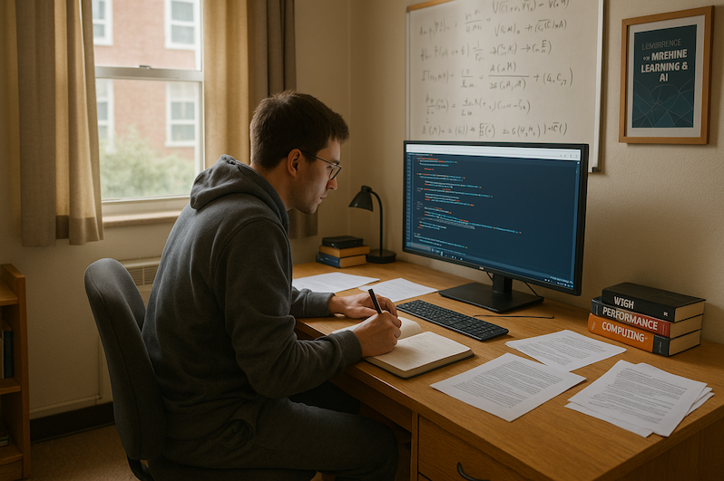

+++
title = 'Foundations of a Future Engineer: A Personal Roadmap'
date = 2025-06-28T01:26:45-05:00
tags = ["Career Advice", "Computer Science", "Education", "Blogging", "Continuous Learning"]
categories = ["Career & Education"]
+++

*<small>A Computer Science Student Studying</small>*

Embarking on a new academic or career journey is exciting, but it can also feel overwhelming. Whether you're just starting university or already a student looking for direction, here’s a roadmap I’ve crafted based on personal experience, habits, and observations. It’s meant to inspire, guide, and ground you as you grow in this fast-changing domain, especially in computer science where the pace of change is intense and constant.

## 1. Start with Motivation and Passion

Before diving deep, ask yourself *why* you want to do this. Motivation and passion are your fuel. Without them, learning can feel like a chore. But when you're driven, challenges become puzzles, not obstacles. If motivation doesn’t come naturally, seek it actively. Join local meetups, school clubs, or hackathons. Take on leadership roles in group activities. Engage with online communities or social media groups that share updates in your field. Seeing how real-world applications align with what you're learning can energize your studies.

## 2. Find a Role Model and Ask Questions

Identify someone whose journey you admire—a professor, developer, researcher, or even a YouTuber. Learn not just what they did, but *how* they think. Having a role model provides clarity, especially early on when everything seems scattered. Ask them questions. Reach out via email, social media, or events. Most people are happy to help if you show genuine interest.

You don’t need to follow just one person. In my case, I started with a few professors, then discovered online educators in 2010 and began engaging with them. Later, I met people from various fields who sparked new interests. Study what made them stand out, and learn from their mindset.

## 3. Take Notes and Keep a Technical Blog

Note-taking should be both private and public. Keep a personal notebook or digital journal, but also consider writing on a technical blog. Share your ideas, summaries, and questions. Repetition reinforces understanding. Over time, you’ll start noticing patterns and connections you didn’t see before. Writing is one of the best ways to internalize what you learn, and a blog also showcases your communication skills to future collaborators or employers.

## 4. Dream Big, But Compete With Yourself

Ambition is important, but your main competition is *you*. Measure progress daily, weekly, monthly, and yearly. Aim to be better than your past self. Mastery is built slowly and intentionally. Tracking growth over time can boost your motivation and help you stay focused.

## 5. Imitate First, Then Innovate

Early on, it's fine to follow tutorials, replicate projects, and study others' work. The key is *doing*. Once you're comfortable, challenge yourself to rebuild from memory. Add your own spin. Even small changes—10% of your own ideas—can make a difference. Gradually, you’ll transition from copying to creating.

To advance further, read academic papers and technical books. Extract core ideas and build mini-projects or custom challenges from them. This method turns passive reading into active learning.

## 6. Learn From Code: Be Active on GitHub

There are thousands of active codebases evolving in every technical subdomain. Make it a habit to explore GitHub. Clone repositories, read the code, run it locally, and understand how it works. Learning from code—especially real-world, community-driven code—is one of the fastest ways to deepen your understanding. Engage by starring, forking, or even contributing.

## 7. Ask for Help

If you're stuck, don't waste days spinning your wheels. Seek guidance. Asking the right question at the right time can save hours. Whether it’s a peer, teaching assistant, professor, or someone online—reach out.

## 8. Build Your Portfolio From Day One

Start documenting your learning journey early. Use GitHub, a personal blog, Notion, or a portfolio website. Add projects, lessons, reflections. Your portfolio is not just a resume—it’s a narrative of your growth and capabilities. It can open doors to internships, collaborations, and job offers.

## 9. Invest in Yourself

Some of the best learning resources are free, but others are worth paying for. Don’t hesitate to buy a course, attend a workshop, or join a conference. These are investments in your future.

## 10. Build Your Network

Establish your network from the very beginning. Classmates, professors, alumni, online peers—anyone can become a future collaborator or connection. Your network is more than just a resource for job opportunities; it's a living learning environment. Don’t isolate yourself. Be part of learning communities, contribute to discussions, attend events, and introduce yourself to new people regularly.

---

This is just a starting point. I plan to update this roadmap as I find sometime interesting and unique in the future. If you're beginning your journey, I hope this blog post offers both encouragement and direction.

Let the journey begin.

