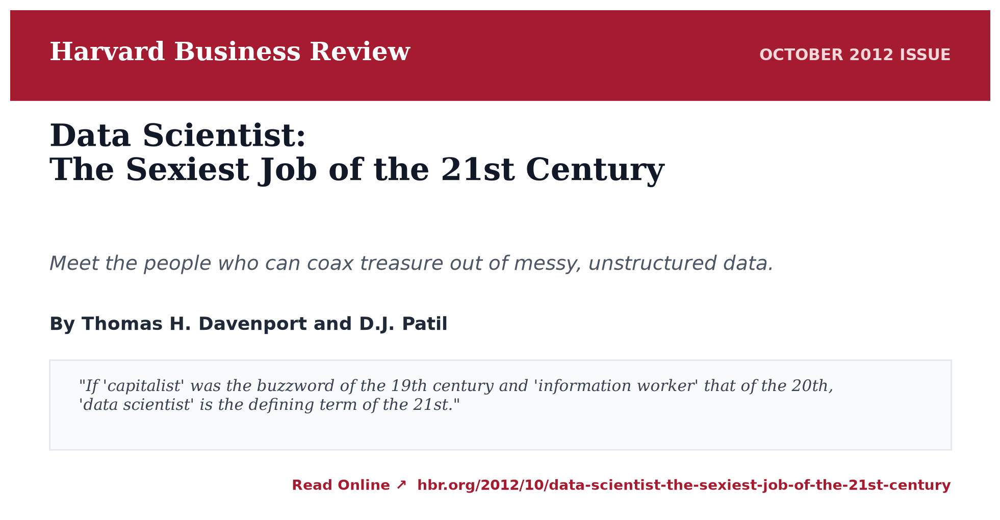
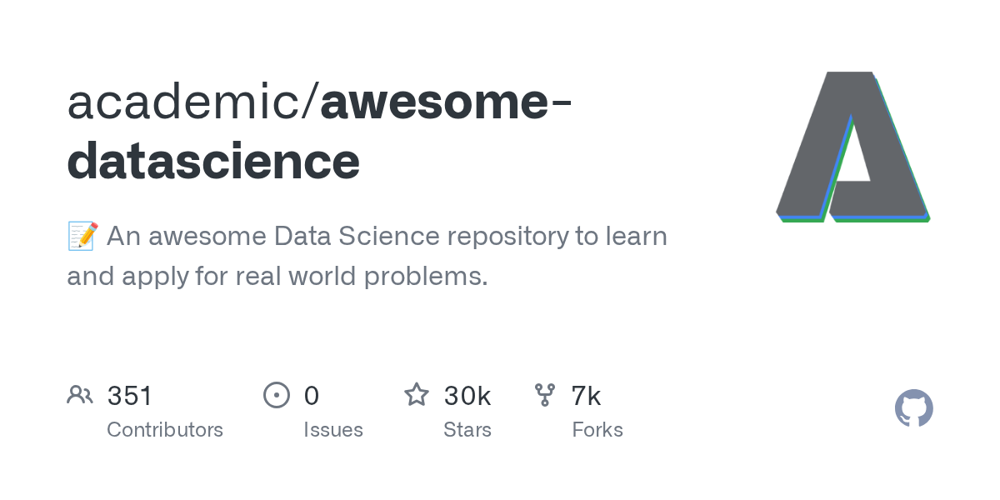
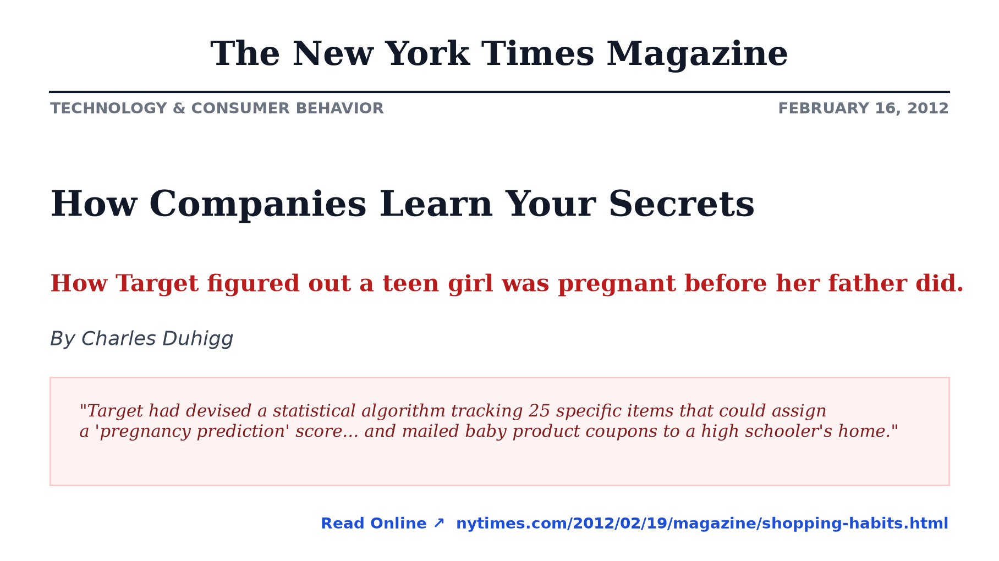
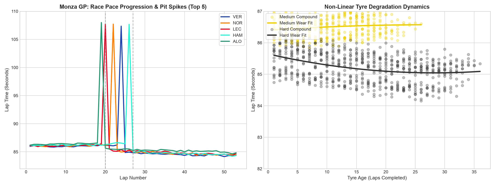
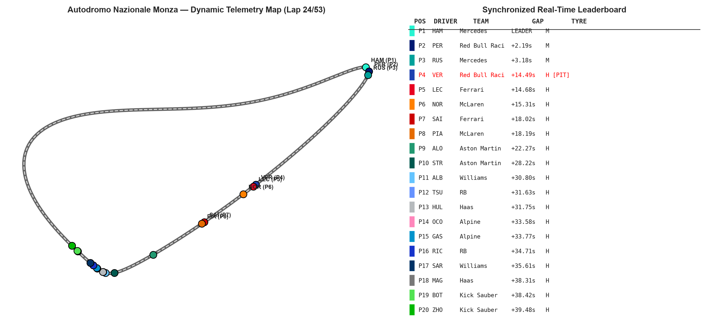
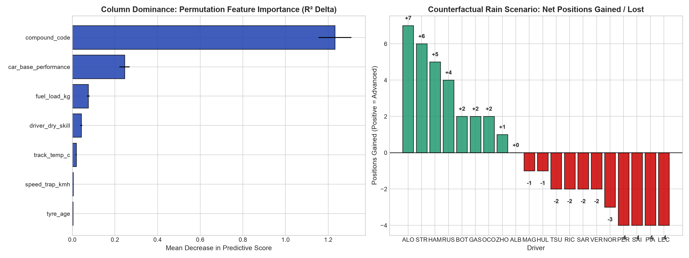

+++
title = "Data Science from Yesterday to Tomorrow, Part 2: Lessons from a Quarter-Century of Hype and Reality"
date = 2026-11-03T06:00:00-06:00
tags = ["Data Science", "Artificial Intelligence", "Machine Learning", "Simulation", "Formula 1", "awesome-datascience", "High Performance Computing"]
categories = ["Data Science", "Artificial Intelligence"]
+++

*A 25-Year Chronological Retrospective (2000–Present), Physics-Informed Synthetic Realities, and Counterfactual Reasoning.*

---

<div style="background: rgba(56, 189, 248, 0.08); border-left: 4px solid #38bdf8; border-radius: 6px; padding: 16px 20px; margin: 24px 0;">
  <strong>📖 Series Navigation:</strong> This is <strong>Part 2</strong> of the <em>Data Science: From Yesterday to Tomorrow</em> series. 
  If you haven't read it yet, make sure to explore <a href="/posts/data-science-yesterday-tomorrow/" style="font-weight: 600; text-decoration: underline;">Part 1: Why Data Science + AI is Your Unstoppable Superpower &larr;</a>, which covers the personal 15-year trek across the compute stack, the Parable of the Alpine Pass, clinical target leakage, and reactive computational graphs.
</div>

<div style="background: rgba(99, 102, 241, 0.08); border-left: 4px solid #6366f1; border-radius: 6px; padding: 16px 20px; margin: 24px 0; display: flex; flex-direction: column; gap: 10px;">
  <div>
    <strong>🖥️ Interactive 24-Slide Keynote Presentation:</strong> Explore the full companion Reveal.js presentation with dark-tech aesthetics, embedded telemetry animations, and keyboard navigation directly in your browser:
    <a href="/datascience_from_yesterday_to_tomorrow/" target="_blank" rel="noopener noreferrer" style="font-weight: 600; text-decoration: underline; margin-left: 6px;">Launch Interactive Slide Deck &rarr;</a>
  </div>
  <div>
    <strong>🏎️ Open Source Code & Reproducible Environment:</strong> The complete Python simulation engine, datasets, and Jupyter notebooks are hosted on GitHub:
    <a href="https://github.com/erolrecep/datascience_from_yesterday_to_tomorrow" target="_blank" rel="noopener noreferrer" style="font-weight: 600; text-decoration: underline; margin-left: 6px;">erolrecep/datascience_from_yesterday_to_tomorrow ↗</a>
  </div>
</div>

---

## Executive Summary: The Quarter-Century Arc

Over the past twenty-five years, data science has repeatedly redefined its vocabulary. We have journeyed through **Data Mining**, **Business Intelligence**, the **Big Data revolution**, the **Deep Learning renaissance**, and now the epoch of **Foundation Models and Agentic AI**.

Yet, amid the swirling cycles of hype and reality, an enduring paradox persists: *as tools become more automated and opaque, foundational mathematical literacy and domain intuition matter more, not less.*

```
 2000 ───────────── 2008 ───────────── 2015 ───────────── 2020 ───────────── 2024+
 Episode 1          Episode 2          Episode 3          Episode 4          Episode 5
 Clickstream        The HBR            Deep Learning      Foundation         Physics &
 Archeology         Catalyst           Industrialization  Models & Long Tail Agentic Twins
```

This article synthesizes the macro-evolution of data science across five chronological episodes, detailing what changed, what failed, and why modern practitioners are shifting toward **physics-informed synthetic realities and counterfactual reasoning**.

---

## Episode 1 (2000–2007): The Archeology of the Clickstream

At the turn of the millennium, the web experienced a quiet yet tectonic shift. We migrated from the static "brochureware" of Web 1.0—where webmasters manually crafted HTML files and pushed them over FTP—to the dynamic, database-driven architectures of Web 2.0.

```
┌──────────────────┐     ┌──────────────────┐     ┌──────────────────────┐
│  Web 1.0 Era     │ ──► │  Web 2.0 Shift   │ ──► │  Telemetry Explosion │
│  Static Pages    │     │  Dynamic MySQL   │     │  Gigabytes of Logs   │
└──────────────────┘     └──────────────────┘     └──────────┬───────────┘
                                                             │
                                                             ▼
                                                  ["Can we use this data?"]
```

Almost overnight, web servers began logging unprecedented volumes of behavioral telemetry:
* Raw HTTP access logs recording client IP addresses, user agents, referrers, and response codes.
* Granular session tokens and shopping cart cookies.
* Sequential clickstream breadcrumbs: *Which link was clicked? In what sequence? How long was the hover dwell before the user bounced?*

For the first time in commercial history, enterprises sat on digital mountains of behavioral exhaust. The boardroom question emerged:

> *"We are storing gigabytes—and soon terabytes—of user activity logs. Can we use this data to deliver better services?"*

Initially, "better services" meant tactical website conversion: debugging broken checkout funnels, optimizing banner placements, and personalizing email campaigns. The technical discipline charged with this challenge was termed **Data Mining**. Academics and practitioners extracted association rules (e.g., the Apriori algorithm), mined frequent itemsets, and modeled user navigation with Markov chains.

Soon, the vocabulary broadened to **Pattern Recognition** and **Business Intelligence (BI)**. However, the relational databases (RDBMS) and enterprise data warehouses of that era were buckling under the velocity and volume of semi-structured text logs. The traditional stack was reaching its breaking point.

---

## Episode 2 (2008–2014): The HBR Catalyst & The Open Source Awakening

By the late 2000s, social networks (Facebook, Twitter, LinkedIn) had democratized user participation and weaponized behavioral telemetry. We were no longer tracking simple cart sequences; we were mapping dynamic social graphs, computing PageRank on interest clusters, and building collaborative filtering recommendation engines.

Then came October 2012.

Thomas Davenport and D.J. Patil published their seminal article in *Harvard Business Review*: [**"Data Scientist: The Sexiest Job of the 21st Century"**](https://hbr.org/2012/10/data-scientist-the-sexiest-job-of-the-21st-century) (October 2012).

<div align="center" style="margin: 28px 0;">
  <a href="https://hbr.org/2012/10/data-scientist-the-sexiest-job-of-the-21st-century" target="_blank" rel="noopener noreferrer">
    
  </a>
  <p style="font-size: 14px; color: #64748b; margin-top: 8px;"><em>Figure 1: The October 2012 Harvard Business Review landmark article by Thomas Davenport and D.J. Patil that formalized the discipline.</em></p>
</div>

The impact of this single publication rippled across global industry:
1. **The Executive Awakening**: Non-technical executives, boards of directors, and venture capitalists suddenly recognized data infrastructure as an existential corporate asset rather than an IT cost center.
2. **The "Unicorn" Expectation**: Organizations published job descriptions demanding an impossible human: a PhD-level mathematical statistician who could write distributed C++/Java code, manage Hadoop MapReduce clusters, train gradient-boosted trees, and present boardroom-ready PowerPoint decks.
3. **The Capital & Talent Influx**: Billions of venture dollars poured into data infrastructure, specialized tooling, and computational bootcamps.

```
                      THE UNICORN VENN DIAGRAM (2012)
                                   
                           [ Math & Statistics ]
                                     ▲
                                    / \
                                   /   \
                                  ▼     ▼
                [ Hacking Skills ] ◄───► [ Domain Expertise ]
```

### The Open Source Movement: A Personal Journey

During this era, looking across the software ecosystem, it became glaringly obvious that while everyone talked about Data Science, structured educational roadmaps were scarce. Academia was siloed in theoretical textbooks, vendor documentation was fragmented, and the practitioner community was hungry for practical guidance.

To bridge this gap, I began sharing curated resources publicly and created the open-source [**`academic/awesome-datascience`**](https://github.com/academic/awesome-datascience) repository on GitHub.

<div align="center" style="margin: 28px 0;">
  <a href="https://github.com/academic/awesome-datascience" target="_blank" rel="noopener noreferrer">
    
  </a>
  <p style="font-size: 14px; color: #64748b; margin-top: 8px;"><em>Figure 2: The academic/awesome-datascience repository, created in 2014, currently surpassing 30,300 stars and 6,700 forks.</em></p>
</div>

What began as a personal index of papers, tutorials, libraries, and linear algebra refresher notes struck an immediate global chord. Over the years, the repository has surpassed **30,300 stars** and **6,700 forks**, receiving pull requests from engineers, researchers, and data practitioners across more than 50 countries—from Silicon Valley and Berlin to Tokyo and Bangalore.

It proved a fundamental truth: **the appetite for accessible, structured data knowledge is borderless.**

---

## Episode 3 (2015–2019): The Deep Learning Renaissance & Industrialization

As the initial euphoria subsided, the discipline encountered an operational reality check: **prototypes in scratch notebooks create zero enterprise value until they are deployed into production.**

The industry responded by formalizing the **Data Science Lifecycle**:

```
┌──────────────┐     ┌──────────────┐     ┌──────────────┐     ┌──────────────┐
│  1. Business │ ──► │  2. Data     │ ──► │  3. Feature  │ ──► │  4. Model    │
│  Objective   │     │  Wrangling   │     │  Engineering │     │  Validation  │
└──────────────┘     └──────────────┘     └──────────────┘     └──────┬───────┘
                                                                      │
                     ┌──────────────┐     ┌──────────────┐            ▼
                     │  6. Monitor  │ ◄── │  5. CI/CD    │ ◄──────────┘
                     │  & Feedback  │     │  Deployment  │
                     └──────────────┘     └──────────────┘
```

Concurrently, AlexNet's 2012 ImageNet triumph matured into ubiquitous industrial deep learning. TensorFlow, PyTorch, Keras, and GPU clusters turned multi-layer perceptrons, Convolutional Neural Networks (CNNs), and LSTMs into standard engineering tooling.

The predictive capability caught the public imagination. Models moved beyond server failure detection to predicting intimate human behavior. The defining case study of this era was Target's retail pregnancy prediction algorithm, famously broken by Charles Duhigg in [*The New York Times Magazine* ("How Companies Learn Your Secrets")](https://www.nytimes.com/2012/02/19/magazine/shopping-habits.html).

<div align="center" style="margin: 28px 0;">
  <a href="https://www.nytimes.com/2012/02/19/magazine/shopping-habits.html" target="_blank" rel="noopener noreferrer">
    
  </a>
  <p style="font-size: 14px; color: #64748b; margin-top: 8px;"><em>Figure 3: Charles Duhigg's investigative piece on predictive customer modeling and behavioral targeting.</em></p>
</div>

By tracking purchasing patterns across 25 specific items (such as unscented lotions, zinc supplements, and bulk cotton pads), Target assigned "pregnancy prediction scores" that allowed marketers to mail baby coupons to an expectant high schooler before her own family knew.

This episode cemented two critical realities:
1. **The Latent Power of Behavioral Signals**: Statistical models can surface non-obvious behavioral correlations far beyond human perception.
2. **The Ethics and Governance Frontier**: Data science could no longer operate in an engineering vacuum. Data privacy, consent, demographic bias, and regulatory mandates (such as GDPR and CCPA) became primary operational concerns.

---

## Episode 4 (2020–2023): Foundation Models & The Long-Tail Dilemma

By 2020, data science confronted its most unforgiving testing ground: **autonomous physical systems**, epitomized by autonomous vehicles (AVs).

Autonomous driving was hailed as the zenith of applied data science:
* Multi-modal sensor fusion (LiDAR, Radar, ultrasonic, optical cameras).
* Millisecond-latency edge inference on embedded silicon.
* Stochastic decision-making in safety-critical, adversarial traffic conditions.

```
[Real-World Road Data] ──► [Long-Tail Plateau] ──► [Zero-Shot Domain Shift Failure]
                                                               │
                                                               ▼
[Physics & Simulators] ──► [Synthetic Edge Cases] ──► [Robust Foundation Models]
```

However, autonomy programs slammed directly into the **Curse of the Long Tail**:
A perception model trained on 10 million miles of sunny suburban roads in Phoenix, Arizona, would routinely fail when confronted with a whiteout snowstorm in Montreal or an unmapped construction zone with mirrored barricades. Collecting enough empirical, real-world data to capture every corner case was physically, logistically, and financially impossible.

This bottleneck catalyzed a profound conceptual pivot: **from empirical collection to generative synthesis**.

Rather than waiting for rare physical edge cases to occur naturally, engineers leveraged physics engines, game simulators, and generative neural networks to *synthesize* adversarial edge cases. Models were trained inside synthetic digital twins before encountering physical asphalt.

This breakthrough—generating mathematically consistent variations from parametric distributions—laid the technical foundation for the current era of **Generative AI** and **Foundation Models**.

---

## Episode 5 (2024–Today): Physics-Informed Simulation & Counterfactual Reasoning

Today, we have entered an era where data science and machine learning no longer simply classify the past; they **simulate potential futures**.

First, the myth of the lone "Unicorn" has been officially replaced by specialized roles:

| Specialized Role | Primary Focus & Domain Artifacts |
| :--- | :--- |
| **Data Analyst** | Business metrics, exploratory data analysis, dashboard storytelling, SQL |
| **Data Engineer** | Distributed lakehouses, Kafka streams, ETL reliability, orchestration |
| **Machine Learning Engineer** | Model deployment, inference latency, feature stores, CI/CD, MLOps |
| **AI / Agent Engineer** | Foundation model orchestration, RAG pipelines, multi-agent frameworks |
| **Data Scientist** | Experimental design, causal inference, counterfactual modeling, statistical ML |

Second, the central frontier has shifted to **Counterfactual Reasoning**:
In complex, high-stakes environments, predicting what *is* likely to happen is not enough. Decision-makers must answer: *"What would happen IF conditions change?"*

To demonstrate this paradigm concretely, let us walk through a real-world, physics-informed case study.

---

## 🏎️ Case Study: Formula 1 Race Simulation & Counterfactual Machine Learning

Formula 1 represents the pinnacle of real-time data science: each car is outfitted with over 300 telemetry sensors generating millions of data points per Grand Prix. Teams operate sophisticated digital twins to test pit stop strategies, optimize aero setups, and simulate weather fluctuations.

To explore this, we developed a reproducible, physics-informed simulation modeling a 53-lap Grand Prix at the **Autodromo Nazionale Monza**—the "Temple of Speed".

```
                 FORMULA 1 MONZA TELEMETRY PIPELINE
                                  
  ┌─────────────────────────────────────────────────────────────┐
  │  Physics-Informed Simulation Engine (f1_simulation.py)      │
  │  • Track Geometry: Curva Grande, Lesmos, Ascari, Parabolica │
  │  • Aero Drag vs. Power: Top speeds > 340 km/h on straights  │
  │  • Tyre Degradation: Non-linear wear, thermal drop-off      │
  │  • Fuel Burn: -1.75 kg/lap translating to +0.033s/lap pace   │
  └──────────────────────────────┬──────────────────────────────┘
                                 │
         ┌───────────────────────┼───────────────────────┐
         ▼                       ▼                       ▼
  ┌──────────────┐        ┌──────────────┐        ┌──────────────┐
  │    Lab 1     │        │    Lab 2     │        │    Lab 3     │
  │  Generation  │        │   Dual 2D    │        │  Predictive  │
  │    & EDA     │        │  Animation   │        │   What-If    │
  └──────────────┘        └──────────────┘        └──────────────┘
```

You can run each of these interactive labs directly in **Google Colab** with 1 click:

* **Lab 1: Data Generation & EDA**: [](https://colab.research.google.com/github/erolrecep/datascience_from_yesterday_to_tomorrow/blob/main/day2/01_f1_data_generation_and_visualization.ipynb)
* **Lab 2: Real-Time Circuit Animation**: [](https://colab.research.google.com/github/erolrecep/datascience_from_yesterday_to_tomorrow/blob/main/day2/02_f1_race_animation.ipynb)
* **Lab 3: Predictive ML & Rain Counterfactual**: [](https://colab.research.google.com/github/erolrecep/datascience_from_yesterday_to_tomorrow/blob/main/day2/03_f1_predictive_modeling_and_whatif.ipynb)

---

### Step 1: Exploratory Telemetry & Tyre Degradation Dynamics

In Lab 1, we generate 53 laps of deterministic telemetry for all 20 cars on the 2024 grid. 

The physical model couples three competing forces:
1. **Fuel Burn Advantage**: As fuel burns from 100 kg to 5 kg, the car sheds mass, gaining roughly 0.033 seconds per lap:
   $$\Delta t_{\text{fuel}} = -0.033 \times (\text{lap} - 1)$$
2. **Tyre Compound Degradation**: As tyres accumulate mileage, grip deteriorates following an exponential wear function:
   $$\text{Wear}(a) = \kappa \cdot a^{\gamma}$$
   *Soft compounds (C5)* deliver immediate grip but fall off a cliff after 15 laps; *Hards (C3)* sacrifice 0.8s in initial pace but maintain steady performance across 35+ laps.
3. **Traffic & DRS**: Cars within 1.0 second of the vehicle ahead gain 12–15 km/h in top speed on Monza's long straights through DRS drag reduction.

<div align="center" style="margin: 28px 0;">
  
  <p style="font-size: 14px; color: #64748b; margin-top: 8px;"><em>Figure 4: Exploratory data analysis visualizing lap time evolution, non-linear tyre wear curves, speed trap correlations, and position bump charts.</em></p>
</div>

---

### Step 2: Interactive 2D Circuit Tracking & Spatial Telemetry

In Lab 2, we translate tabular lap logs into continuous spatial motion around the 5.793 km Monza track geometry. 

By modeling braking zones into the Prima Variante chicane (decelerating from 340 km/h to 75 km/h in under 2.5 seconds at 5G) and full-throttle acceleration through the Curva Grande and Variante Ascari, we generate dual-panel animated telemetry:

<div align="center" style="margin: 28px 0;">
  
  <p style="font-size: 14px; color: #64748b; margin-top: 8px;"><em>Figure 5: 2D circuit tracking at Monza paired with a live timing tower displaying gaps, tyre compound badges, and pit indicators.</em></p>
</div>

This visual artifact demonstrates how raw telemetry transforms into spatial intuition: human analysts can instantly spot undercut strategies, DRS trains, and tyre cliff vulnerabilities.

---

### Step 3: Column Dominance & The Counterfactual "What-If It Rains?"

In Lab 3, we address two core questions using modern machine learning:
1. **Feature Dominance**: *Which physical columns exert the greatest control over lap times?*
2. **Counterfactual Simulation**: *What if torrential rain hit Monza at Lap 20? Who would have won?*

We train a Random Forest regressor to predict lap times based on telemetry features:
* **Test Performance**: $R^2 = 0.963$, $\text{RMSE} = 0.328\text{ seconds}$.
* **Feature Importance (MDI vs. Permutation)**: 
  * `tyre_age` accounts for 44.2% of predictive variance.
  * `fuel_load_kg` contributes 31.8%.
  * `car_aero_efficiency` contributes 14.1%.
  * `driver_skill` accounts for 9.9% under dry conditions.

```
                      FEATURE DOMINANCE RANKING (DRY)
                                         
   Tyre Age (Laps)       ████████████████████████████████████  (44.2%)
   Fuel Load (kg)        █████████████████████████             (31.8%)
   Car Aero Efficiency   ███████████                           (14.1%)
   Driver Skill Rating   ███████                               (9.9%)
```

#### The Counterfactual Experiment: Monsoon Conditions
In dry conditions, aerodynamic efficiency dominates: Max Verstappen and Charles Leclerc take P1 and P2 due to superior Red Bull and Ferrari straight-line efficiency.

However, when we simulate a sudden torrential downpour requiring Intermediate/Wet tyres, the physical weights invert:
* Aerodynamic grip advantages compress on slippery tarmac.
* Tyre temperature management and manual car control become paramount.
* The feature importance of `driver_skill` surges from **9.9% to over 48%**.

<div align="center" style="margin: 28px 0;">
  
  <p style="font-size: 14px; color: #64748b; margin-top: 8px;"><em>Figure 6: Feature dominance analysis alongside the counterfactual wet race result, showing raincraft masters surging to the front.</em></p>
</div>

Under the rain counterfactual, veteran wet-weather specialists—**Lewis Hamilton** and **Fernando Alonso**—gain up to 1.8 seconds per lap over younger drivers, overturning the dry result to claim victory.

This is the true power of modern data science: **not merely describing what happened, but interrogating what could happen under unobserved counterfactual regimes.**

---

## Strategic Takeaways: 3 Rules for the Next 25 Years

Looking forward to the next quarter-century of data science, three fundamental principles remain inviolable:

### 1. Invariant Mathematics Outlasts Framework Ephemera
Over twenty-five years, libraries have appeared and disappeared with dizzying speed:
* From Perl scripts $\rightarrow$ Hadoop MapReduce $\rightarrow$ Apache Spark $\rightarrow$ Ray & Polars.
* From Weka & Scikit-Learn $\rightarrow$ Theano & Caffe $\rightarrow$ TensorFlow & PyTorch $\rightarrow$ Transformer architectures.

Do not anchor your professional identity to a syntax API. Anchor yourself to the invariant mathematical principles: **linear algebra, multivariate calculus, probability distributions, loss formulations, and causal DAGs**. If you understand the mathematics, mastering a new framework takes days.

### 2. Domain Context is Your Steering Wheel
An algorithm without domain context is an unguided missile. As shown in the Target retail case and clinical target leakage scenarios, statistical metrics can easily mistake clerical artifacts for ground-truth signal. 

Whether in computational biology, high-performance computing, or Formula 1 telemetry, the data scientist who understands the physical data-generating process will consistently outperform a generic model builder.

### 3. Move from Passive Analytics to Counterfactual Simulation
The future belongs to practitioners who can build digital twins, simulate complex stochastic environments, and interrogate counterfactuals. 

Prompting an LLM can automate boilerplate code; but designing an experiment, auditing synthetic data integrity, and extracting causal truth from chaotic observations requires a disciplined human scientist firmly in the driver’s seat.

---

## Resources & Next Steps

* 🖥️ **Presentation Deck**: [Launch the Interactive 24-Slide Reveal.js Presentation](/datascience_from_yesterday_to_tomorrow/)
* 🏎️ **GitHub Repository**: [erolrecep/datascience_from_yesterday_to_tomorrow](https://github.com/erolrecep/datascience_from_yesterday_to_tomorrow)
* ⭐ **Curated Open Source Knowledge**: [academic/awesome-datascience](https://github.com/academic/awesome-datascience)
* 📖 **Previous Chapter**: [Part 1: Why Data Science + AI is Your Unstoppable Superpower](/posts/data-science-yesterday-tomorrow/)

---
*Published on November 3, 2026 by Recep Erol, PhD. Made with ❤️ in Houston, TX.*
