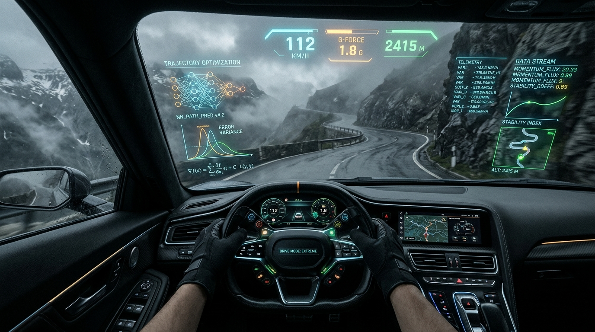

+++
title = "From Yesterday to Tomorrow: Why Data Science + AI is Your Unstoppable Superpower"
date = 2026-10-20T20:45:00-05:00
tags = ["Data Science", "Artificial Intelligence", "Machine Learning", "High Performance Computing", "Career Advice", "Marimo"]
categories = ["Data Science", "Artificial Intelligence"]
+++

*A 15-year journey from commodity laptops and MapReduce to supercomputers, Walmart patents, and foundation models—and why foundational rigor matters more than ever.*

---

<div align="center">
  
  <p><em>Figure: Navigating the alpine pass with live telemetry, neural path predictions, and data science rigor—keeping the human firmly in the driver’s seat.</em></p>
</div>

<div style="background: rgba(56, 189, 248, 0.08); border-left: 4px solid #38bdf8; border-radius: 4px; padding: 14px 18px; margin: 24px 0;">
  <strong>📊 Accompanying Keynote Slide Deck:</strong> You can explore or present the full 25-slide interactive presentation deck in your browser with speaker notes, keyboard navigation, and full-screen support: 
  <a href="presentation_deck.html" target="_blank" rel="noopener noreferrer" style="font-weight: 600; text-decoration: underline;">Launch Interactive Slide Deck &rarr;</a>
</div>

## 1. The Phantom Fear in the Lecture Hall

If you walk across any university campus today—whether into an undergraduate computer science lab, a graduate statistics seminar, or a post-doctoral research commons—you will encounter a palpable, suffocating anxiety.

Students who spent the last two years staying up late to master Python syntax, dissect Pandas DataFrames, and derive gradient descent are staring at their screens with a sinking feeling in their stomachs. An LLM can now ingest a messy CSV, write 150 lines of clean Python, generate five exploratory visualization charts, and train an ensemble model in under thirty seconds. Autonomous coding agents run multi-step analytical pipelines while their creators sleep.

The questions I hear from students, post-docs, and even early-career faculty are always the same:

> *"Is what I am studying already obsolete?"*  
> *"Should I stop learning data science and just become a prompt engineer?"*  
> *"Is there any room left for human scientists?"*

I understand that anxiety intimately. But I am here to tell you that this panic is based on a fundamental misunderstanding of what science actually is.

**Prompt-only knowledge is hollow.** If your entire skillset consists of asking an AI model to write scripts, you are building your career on wet sand. You cannot debug what you do not understand; you cannot verify what you cannot mathematically formulate; and you will inevitably steer your projects straight off an intellectual cliff.

However, if you combine **uncompromising foundational knowledge in data science** with **modern agentic AI tools**, you will not be replaced. You will become an unstoppable, 10x force multiplier. You will step into the future not as an anxious passenger, but as a scientist firmly in the **driver’s seat**.

To understand why this is true, let me take you back to where my own journey began fifteen years ago.

---

## 2. The 15-Year Trek Across the Compute Stack

### 2010: The Spark, the Underpowered Laptop, and 10 Online Courses
In 2010, the term "Data Science" had barely breached the public consciousness. I was an undergraduate student fascinated by the possibilities of scientific computing. I attended a local conference where someone mentioned an emerging underground ecosystem in Python: NumPy, SciPy, and an interactive shell called IPython. At the same time, the industry was abuzz with the thunderous arrival of "Big Data," Hadoop, MapReduce, and NoSQL databases.

I wanted desperately to learn. The industrial gold standard of the day was the Hortonworks Sandbox—a virtual machine package containing Hadoop, Zookeeper, and Hive. But there was a major problem: **my student computer was far too weak to even download, install, and run the sandbox.**

I had every excuse to give up and say, *"The technology has passed me by."* Instead, I turned to the very first wave of massive open online courses (MOOCs) on Coursera and Udacity. I completed more than ten courses back-to-back, studying late into the night, absorbing linear algebra, algorithmic complexity, and probability theory. That self-motivated crucible proved something foundational: **tools and frameworks are transient; the appetite for self-directed learning is your only permanent asset.**

When *Harvard Business Review* published its famous 2012 article declaring Data Scientist *"The Sexiest Job of the 21st Century,"* I was already deep in the trenches. To help organize this exploding, chaotic domain, I started an open-source GitHub repository: `awesome-datascience`. What began as a personal curated list blossomed into a global nexus with tens of thousands of stars, hundreds of contributors, and speaking invitations worldwide. Open source taught me that knowledge compounds most powerfully when it is shared freely.

```
                           THE COMPOSITE SKILL STACK
                                        
   ┌────────────────────────────────────────────────────────────────────────┐
   │  Layer 6: Computational Scientist for AI & PhD (Continuous Learning)   │
   ├────────────────────────────────────────────────────────────────────────┤
   │  Layer 5: Supercomputing & HPC (Heterogeneous GPUs, Terabyte Scaling)  │
   ├────────────────────────────────────────────────────────────────────────┤
   │  Layer 4: Enterprise Scale ($30B Problem, 2 Walmart Patents)           │
   ├────────────────────────────────────────────────────────────────────────┤
   │  Layer 3: Medical Image Analytics & Surgical Simulation (High Stakes)  │
   ├────────────────────────────────────────────────────────────────────────┤
   │  Layer 2: Edge Computing & UAVs (Physical Latency & Memory Ceilings)   │
   ├────────────────────────────────────────────────────────────────────────┤
   │  Layer 1: Network Sockets, Relational Schemas, Data Mining & Stats     │
   └────────────────────────────────────────────────────────────────────────┘
```

### Traversing the Layers of the Engineering Stack
My career did not follow a straight, comfortable line. To understand data, you must understand the substrate through which data flows:

1. **Network Programming to Databases:** I began with network programming, understanding sockets, packets, and latency, before moving into data mining, classical statistics, and web system architectures. If you do not understand relational schemas and data normalization, you will spend your life cleaning preventable garbage upstream.
2. **The Physical Edge & UAVs:** I moved into computer vision and edge computing, writing image-processing pipelines designed to run on resource-constrained embedded devices aboard Unmanned Aerial Vehicles (drones). At the physical edge, you quickly learn that you cannot hide behind an infinite cloud cluster. Every milliwatt and every byte of RAM matters.
3. **Medical Imaging & Surgical Simulation:** I transitioned into the high-stakes biomedical domain, analyzing surgical simulation testing and evaluating physiological outcomes. In medical data science, a false positive or an uncalibrated confidence interval does not just hurt a metric—it has real clinical consequences.
4. **The $30 Billion Corporate Frontier:** Moving into the corporate arena, I was tasked with addressing a massive $30 Billion problem, an experience that resulted in **two patents owned by Walmart**. At enterprise scale, algorithmic brilliance is meaningless unless it can be translated directly into operational efficiency and measurable business value.
5. **Supercomputing, HPC & Heterogeneous Optimization:** My academic journey culminated in spending six years immersed in academic research, high-performance computing (HPC), and supercomputing clusters. I worked on scaling pipelines processing terabytes of data down from multi-day bottlenecks to mere hours. We engineered heterogeneous hardware systems (balancing multi-core CPUs, GPUs, and custom accelerators), researched energy-efficient "green" computing, and led national workforce development programs in distributed computing.

Eventually, I earned my **PhD in Artificial Intelligence** and stepped into the role of a **Computational Scientist for AI**. 

I share this trajectory not as a resume, but as empirical proof of one vital principle: **Every single layer of that stack compounded into the next.** My network programming informed my database design; my edge-computing constraints informed my supercomputing optimizations; my medical simulation rigor informed my enterprise AI models.

And here is the most humbling truth I can share with you: **Even with a PhD in AI, I still spend time every single week learning what is new. If I stop learning for six months, I too will become obsolete.** The learning never ends. That is not a curse—it is the greatest privilege of our discipline.

---

## 3. The Parable of the Alpine Pass: Why "AI-Only" Knowledge is Fatal

To understand why you must master data science foundations rather than just prompt engineering, consider this parable.

```
                    THE PARABLE OF THE ALPINE PASS
                                                    
      Dense Fog & Black Ice Ahead                 
             ▲       ▲                            
            /         \                           
           /   [?]     \                          
     ─────┘             └────── Hairpin Turn Ahead
    
    PASSENGER (Prompt-Only):             PILOT (Data Scientist):
    • "Car, go to the top fast!"         • Uses autonomous assist
    • Cannot read traction loss          • Audits telemetry in real time
    • Blind to sensor illusions          • Understands physics of black ice
    • Crashes at the hairpin             • Overrides autopilot; reaches summit
```

Imagine you are handed the keys to the most advanced autonomous supercar ever created. It features Level 4 autonomous driving, dual-turbo electric propulsion, and LiDAR sensors scanning the road a thousand times a second. It can accelerate from 0 to 60 mph in two seconds and can follow digital lane markings with millimeter precision.

Now, picture two different people sitting in the driver’s seat at the base of a perilous mountain pass at midnight. A blizzard is raging; the road is coated in black ice, and a thick fog bank drops visibility to zero.

* **Person A (The AI-Only Passenger):** Person A has never studied physics, has never driven a manual car, and doesn't know how tire friction behaves at freezing temperatures. They smile at the dashboard, push the autopilot button, and type a prompt: *"Drive me to the summit as fast as possible."* The vehicle launches forward with blinding speed. But as the car hits the switchbacks, the optical cameras are blinded by the swirling snow. The road surface changes to near-frictionless black ice. The GPS signals bounce off the granite cliff faces, creating a multi-meter positional error. The car’s neural network, trained on dry highway footage, continues to command high throttle into a 90-degree hairpin turn. Person A has no idea danger is imminent—until the car spins violently off the ledge into the abyss.
* **Person B (The Data Scientist in the Driver’s Seat):** Person B happily uses the car’s advanced features. They engage the computerized traction control, let the anti-lock brakes pulse at millisecond intervals, and use the heads-up display. But Person B **knows the physics of the mountain**. They know that when ambient temperature hits 31°F, moisture creates invisible ice. When the telemetry display flashes an anomalous lateral acceleration reading, Person B immediately recognizes that the camera sensors are hallucinating traction. Person B instantly taps the brakes, overrides the autopilot, counter-steers with deliberate manual control, and guides the machine safely around the precipice to the summit.

### The Reality: The 99.7% Clinical Model That Kills
This is not mere storytelling. This happens every single day in machine learning.

Imagine an inexperienced practitioner who only knows how to use AI coding agents. They are handed a clinical dataset containing 50,000 hospital patient records and told to build a model that predicts whether a cancer patient will achieve remission.

The prompt-jockey writes to an LLM: *"Build an XGBoost pipeline on this CSV, perform cross-validation, and optimize for AUC."* 

Within 45 seconds, the AI writes the code, cleans the missing fields, tunes the hyperparameters, and reports a staggering **99.7% ROC-AUC score**. The prompt-only user is ecstatic. They paste the confusion matrix into a slide deck, present it to hospital leadership, and declare that AI has solved cancer prognosis.

Then, an experienced data scientist sits down in the driver’s seat. They inspect the feature importance matrix. They notice that the single most predictive feature in the entire model is an obscure column named `DISCH_CODE_902`. 

They walk down to the hospital records department and ask what that code means. The medical clerk answers: 

> *"Oh, `902` is the administrative billing code we enter into the accounting system when a patient is formally discharged after completing full remission."*

**The model didn't discover a biological cure; it discovered a clerical artifact.** It was predicting remission based on a billing code that is only generated *after* a patient is already cured. It is classic, catastrophic **target leakage**. 

Had that model been deployed into clinical triage, doctors would have withheld intensive treatment from dying patients simply because a clerical billing box had not yet been checked. 

**The AI did not catch this error.** The AI *cannot* catch this error. To the LLM and the loss function, the billing code was mathematically flawless signal. It required a human scientist—someone who understands how data is physically generated, who possesses domain skepticism, and who interrogates anomalies—to save human lives.

---

## 4. The Modern Frontier: Reactive Workflows and Deterministic State

When we talk about using AI responsibly, we must also update the tools we use to think.

For the past decade, the dominant canvas for data science has been the traditional Jupyter notebook. While revolutionary in its time, legacy notebooks introduced a notorious problem: **hidden, non-linear state.** You run cell 15, then scroll up to modify cell 3, then run cell 7. Your variable state is now an unrepeatable tangled mess. If you feed an AI coding assistant into that chaotic environment, the AI will happily hallucinate fixes based on stale variables that no longer exist in memory.

This is why modern data scientists are gravitating toward **reactive, deterministic platforms like [marimo](https://marimo.io)**. 

Unlike traditional notebooks, marimo models your entire analysis as a pure **Directed Acyclic Graph (DAG)**:
* If you change a slider or modify an upstream data-cleaning cell, **all downstream dependencies automatically and deterministically re-execute**.
* There are no hidden global states.
* It stores notebooks as pure, versionable Python scripts—making them natively friendly to Git and modern CI/CD pipelines.
* It embeds AI natively within a reactive architecture, meaning the AI copilot operates within a deterministic computational context rather than an unstable memory dump.

Platforms like marimo represent the future: tools that eliminate mechanical friction, guarantee reproducibility, and empower you to explore hypotheses interactively without losing scientific rigor.

---

## 5. The Future Practitioner’s Playbook: How to Build an Unshakeable Career

If you are a student, post-doc, faculty member, or researcher looking to thrive in the era of Agentic AI, here is your concrete, actionable roadmap:

```
                       THE MODERN DATA SCIENCE TRIAD
                                        
                               [ DOMAIN CONTEXT ]
                            (Genomics, Retail, Logistics)
                                        ▲
                                       / \
                                      /   \
                                     /     \
                                    ▼       ▼
                [ RIGOROUS FOUNDATIONS ] ◄───► [ AGENTIC AI TOOLS ]
             (Linear Algebra, Stats, SQL)     (LLMs, Marimo, Multi-Agent)
```

### 1. Cement Your Foundations (The Invariant Core)
Frameworks come and go. When I started, people swore by Theano; then came Caffe, Torch, TensorFlow, and PyTorch. Tomorrow it will be something else. Do not tie your identity to a Python syntax library. Tie your foundation to the invariant mathematics:
* **Linear Algebra:** Understand projections, matrix decompositions (SVD, QR), eigenvalues, and high-dimensional vector geometry. Vector embeddings are the universal currency of modern AI.
* **Probability & Mathematical Statistics:** Master hypothesis testing, Bayesian updates, confounding variables, selection bias, and causal Directed Acyclic Graphs (DAGs).
* **Data Structures & Relational Theory:** Learn how data is stored, indexed, queried (SQL), and partitioned across distributed disks.

### 2. Cultivate Asymmetric Domain Expertise
A generic data scientist who only knows how to run generic models on clean tabular data is easily automated. But a data scientist who understands **genomics and CRISPR sequences**, or **supply chain logistics and warehouse queueing theory**, or **computational fluid dynamics and wind-tunnel data** is completely irreplaceable. 

Pick a domain that fascinates you. Dive into its specialized literature. Learn how its instruments measure the physical world. Your domain expertise is the steering wheel; data science is the engine.

### 3. Build a "Living Portfolio" (Kill the Titanic Dataset)
If I see one more resume listing a project predicting survival on the Titanic or classifying handwritten digits on MNIST, I will lose my mind. Those are homework assignments, not portfolios.
* **Tackle Messy, Uncurated Problems:** Scrape real-world data from local government portals, hook into live public transit APIs, or capture sensor readings from an IoT board.
* **Publish Interactive, Reproducible Work:** Host an interactive dashboard (using marimo, Streamlit, or WebAssembly) where visitors can tweak parameters and see live inferences.
* **Write Honest Post-Mortems:** Write blog posts detailing where your model failed, what confounding variables tricked you, how you discovered target leakage, and how you fixed it. Employers and lab directors don't hire people who claim 100% accuracy; they hire forensic investigators who know how to diagnose failure.

### 4. The Outreach Algorithm: How to Network Authentically
Do not blast generic connection requests across LinkedIn. When I started, I reached out directly to the researchers, authors, and open-source contributors whose work I admired:
* **Engage with Preprints:** Read new papers on arXiv, bioRxiv, or institutional repositories. If an author publishes their code on GitHub, clone it, run it, and if you spot a typo or an unhandled edge case, submit a respectful pull request or open an issue.
* **Email with Substantive Curiosity:** Send a brief, informed note to a professor or lab director:  
  > *"Dear Dr. [Name], I read your recent paper on [Topic]. I replicated your experiment on a different subset of data and noticed this interesting divergence in convergence rates. Here is my 2-page reproducible marimo notebook. Are you accepting graduate research assistants for this upcoming term?"*  
  That kind of informed, value-first outreach puts you in the top 1% of applicants globally.
* **Contribute to Open Source:** Start small. Fix documentation, write missing unit tests, or help curate community repositories like `awesome-datascience`. Open-source contributions are a public, immutable ledger of your work ethic and collaborative ability.

---

## 6. Epilogue: The Compass and the Steering Wheel

We stand at the most exhilarating threshold in the history of human computation. 

Never before has an undergraduate student had access to supercomputing-scale analytical intelligence sitting right inside their browser. Never before could a solo researcher formulate an idea in the morning and have an agentic workflow prototype twenty iterations by sunset.

Do not fear these tools. Do not run from them, and do not pretend they do not exist. But above all, **do not surrender your intellect to them.**

AI is the most powerful engine humanity has ever built. But an engine has no purpose without a destination, no caution without a driver, and no conscience without a human soul. 

Learn the math. Interrogate the data. Master the tools. And keep your hands firmly on the wheel.

---

### Author Note & Workshop Resources
*This post is derived from the keynote address and hands-on workshop "From Yesterday to Tomorrow: Data Science & Agentic AI". To explore the interactive reactive notebooks, reproduction scripts, and target-leakage case studies demonstrated in this talk, visit our open-source workshop repository at: [github.com/erolrecep/from-yesterday-to-tomorrow-ds](https://github.com/erolrecep/from-yesterday-to-tomorrow-ds).*
