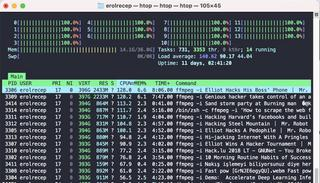
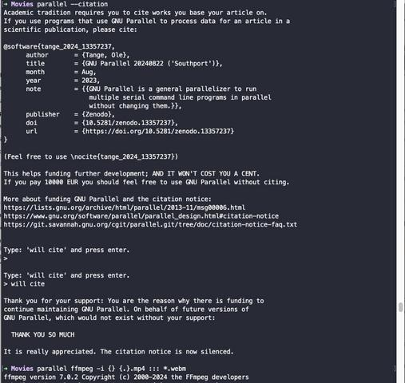

+++
title = 'GNU Parallel for Your Terminal Tasks'
date = 2024-10-28T21:18:27-05:00
tags = ["Linux", "CLI", "GNU Parallel", "High Performance Computing", "Automation", "Productivity"]
categories = ["High Performance Computing", "DevOps & Tooling"]
+++

In today's fast-paced world, efficiency is key, especially when working with multiple files and processes. Enter [GNU Parallel](https://www.gnu.org/software/parallel/), a powerful command-line tool that can help you streamline your terminal tasks by running them in parallel. In this blog post, we’ll explore what GNU Parallel is, how to install and use it, and some practical use cases that demonstrate its capabilities.

## What is GNU Parallel?

GNU Parallel is a command-line utility designed to execute jobs in parallel, leveraging your system's resources more effectively. Whether you're converting files, processing data, or running scripts, if you can do it in the terminal, you can probably use GNU Parallel to speed it up. This tool is perfect for anyone who relies on the terminal for their daily tasks and wants to optimize their workflow.

## Installation and Usage

Installing GNU Parallel is straightforward. On most Linux distributions, you can install it using your package manager. For example, on Debian-based systems, you can use:

```bash
sudo apt-get install parallel
# or
brew install parallel
```

Once installed, you can start using it immediately. The basic syntax is simple:

```bash
parallel [options] command ::: arguments
```

This allows you to run a command with multiple sets of arguments concurrently.

## The Power of Parallel

One of the standout features of GNU Parallel is its ability to cite tasks effectively, which can enhance the way you structure and manage your jobs. By incorporating it into your daily routine, you can significantly cut down on processing time.

## My Daily Tools and Workflows

As someone who frequently uses various terminal tools, I rely on GNU Parallel to combine these tools and handle multiple tasks simultaneously. Some of my go-to tools include:

- **GraphicsMagick**: For image manipulation and conversion.
- **FFmpeg**: For video processing and format conversions.
- **SoX**: For audio processing tasks.
- **Python scripts**: Running multiple Python jobs in parallel.

## Use Cases

Let’s get into some specific workflows where I utilize GNU Parallel:

### Converting Images to Grayscale
While I could write Python scripts using OpenCV or PIL to accomplish this, using GraphicsMagick with GNU Parallel is much faster and simpler. A command like this can handle multiple images at once:

   ```bash
   gm convert *.jpg -colorspace Gray -parallel 4 output_%d.jpg
   ```

Additionally, there are other ways that you can employ the parallel for a similar task,

   ```bash
   parallel gm convert {} {.}.jpg ::: *.webp
   ```
In this example, gets all the webp files in the same directory and converts them into jpg file type. By using ":::", you let parallel to use all the resources necessary for this task.

For more detailed operations for gm convert, please visit [GraphicsMagick convert docs](http://www.graphicsmagick.org/convert.html)


### Audio File Processing
When working with audio files, I often need to convert them into a specific format. GNU Parallel allows me to process multiple files concurrently, making audio conversion a breeze. For instance, if you want to transcribe a set of audio files and write the results to corresponding output files, here’s a streamlined workflow. If the recorded files are in MP3 format, you first need to convert them into WAV files, then use these WAV files with a transcription script to generate the outputs. Here’s how it looks in terminal commands:

   ```bash
   ls *.mp3 | parallel 'sox {} {.}.wav'
   # or
   parallel sox {} {.}.wav ::: *.mp3

   # then

   ls *.wav | parallel 'python transcribe.py -i {} -o {.}.json' 
   ```
See, if you know what to do, automating tasks becomes as easy as painting your own Mona Lisa!


### Word Counting
If I want to count the number of words in multiple text files, I can do so efficiently with a single command:

   ```bash
   parallel wc ::: *.txt
   ```
Have you mess with "Word count" mapreduce problem on distributed computing? Think about this, if you a little bit of bash scripting and text parsing with it, without setting up such environment for word count problem, you can easily build your own workflow with the tools including, we, parallel, and a little bit or awk and bash scripting, you can easily automate the mapreduce program with these tools. 


### File Type Conversion 
One of my favorite features of GNU Parallel is its ability to convert multiple file types with a single command. For example, to convert several `.txt` files to `.md`:

   ```bash
   parallel mv {} {.}.md ::: *.txt
   ```

### Miscellaneous Tasks 
Here are some of the one-liners I use almost every day as part of my tasks. Test any of them with your files and types and enjoy the view of htop! :)


   ```bash
   parallel ffmpeg -i {} {.}.mp4 ::: *.webm
   # or
   parallel gm convert {} {.}.jpg ::: *.webp
   ```


   ```bash
   ls *.webp | parallel 'gm convert {} {.}.jpg'
   ```


   ```bash
   cat ids.txt | parallel yt-dlp {.}
   ```

   ```bash
   sh urls.sh | parallel wget {.}
   ```


These one-liners save me significant time and effort.

<div class="row g-4 my-4 align-items-stretch">
  <div class="col-12 col-md-6 d-flex">
    <div class="terminal-img-card w-100">
      <div class="terminal-img-wrapper">
        
      </div>
      <p class="terminal-img-caption">Parallel utilizes all CPU resources (htop view)</p>
    </div>
  </div>
  <div class="col-12 col-md-6 d-flex">
    <div class="terminal-img-card w-100">
      <div class="terminal-img-wrapper">
        
      </div>
      <p class="terminal-img-caption">GNU Parallel Citation for your work</p>
    </div>
  </div>
</div>

In addition to this context, I also shared [a relevant content on my LinkedIn page](https://www.linkedin.com/posts/erolrecep_gnuparallel-activity-7235523998489436160-MA4r/) and community liked it. This tool is incredible! If you use it for the correct purpose, you can't even imagine how useful this tool would be. Saves time, resources, and even shortens the whole processing time.

## Streamlining Workflows

When I have a long list of tasks, I can easily assign them to GNU Parallel, ensuring each job is completed efficiently. After running a set of tasks, I can confirm their completion, allowing for smoother workflows.

## Running SLURM Job Scripts

GNU Parallel also integrates seamlessly with SLURM job scripts, enabling you to manage and execute multiple jobs in a high-throughput computing environment. This flexibility allows you to run the same code with different parameters without modifying your original scripts.

## High Throughput Computing

One of the significant advantages of GNU Parallel is its capacity for high-throughput computing. It can take smaller tasks, run them concurrently, and maximize the efficiency of your system without necessitating changes to your original code. By combining GNU Parallel with other tools, like SCP, you can build robust pipelines for complex computations on any Linux system. I am planing to create another post just for this topic, "_High Throughput Computing with GNU Parallel!_"

## Conclusion

My experience with parallel programming has taught me the importance of leveraging efficient tools like GNU Parallel. I wholeheartedly recommend it to anyone looking to enhance their terminal workflows. Whether you’re processing files, running scripts, or performing complex computations, GNU Parallel can be a game-changer.

Kudos to the developer(s) of GNU Parallel for creating such a powerful tool that opens up new possibilities for productivity in the terminal. Give it a try, and see how it can transform your tasks into streamlined, efficient processes!


