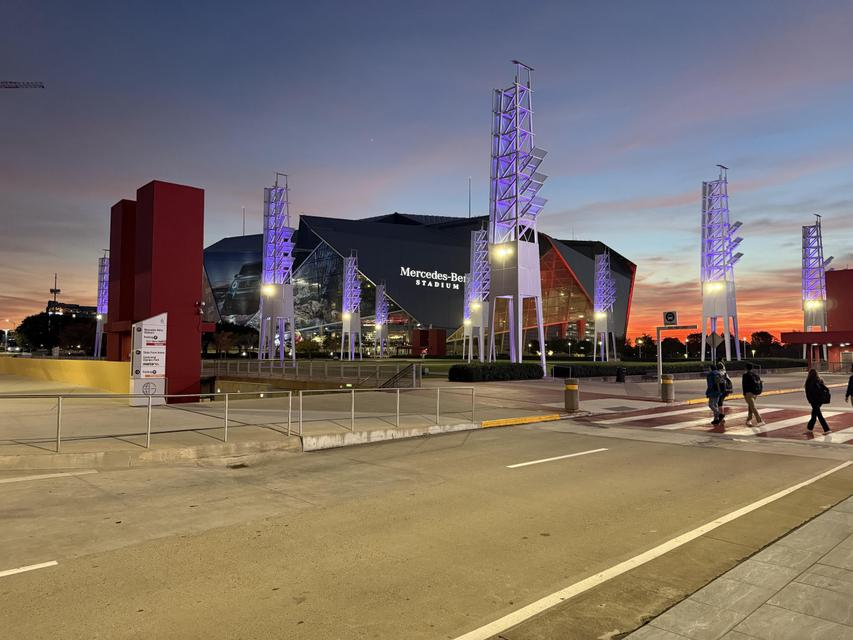
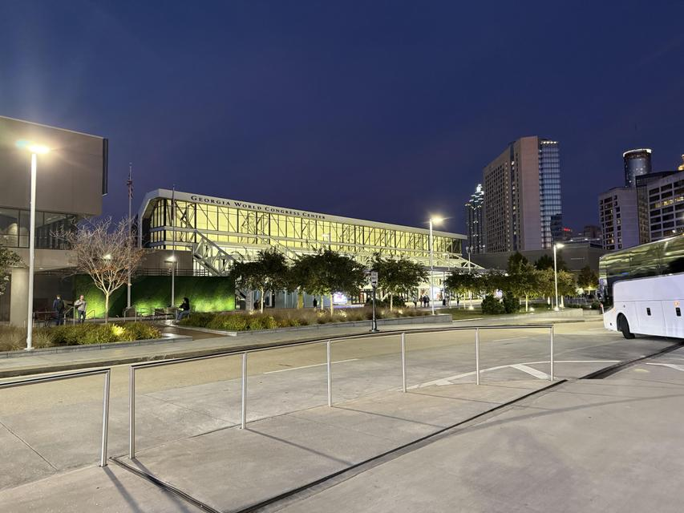
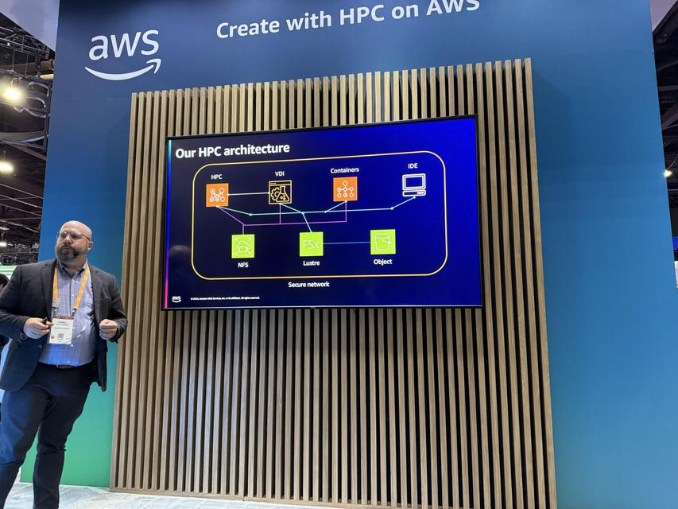
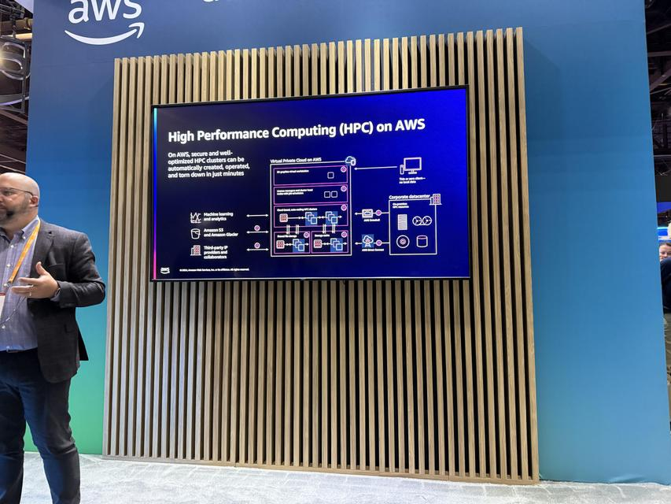

+++
title = '5 days in Atlanta: My Personal Highlights from SC24'
date = 2024-11-28T11:54:34-06:00
tags = ["High Performance Computing", "Supercomputing", "SC24", "Artificial Intelligence", "Mentorship", "Career Advice"]
categories = ["High Performance Computing", "Conferences"]
+++


*<small>SC24 Logo</small>*

&nbsp;

Over the past three years, I’ve had the privilege of attending the Supercomputing (SC) Conference to stay informed about the latest developments, changes, and scientific advancements in the field of supercomputing. In preparation for these experiences, I dedicated myself to building a strong foundation: reading books, taking courses, constructing a mini edge cluster to mimic an HPC center setup, and conducting numerous experiments to explore how different technologies and tools compare.  

This journey finalized in using HPC as a central component of my PhD dissertation, a process that inspired a significant career shift—from a machine learning engineer to an HPC Admin and AI Facilitator. While I now focus on accelerating researchers’ AI workflows and helping them adapt their projects for HPC environments, I still actively use machine learning and AI tools. I also carve out time to fill knowledge gaps and pursue personal research interests.  

This introduction bridges what I do day-to-day with the motivations behind attending SC each year. This blog post highlights my experiences and key learnings from SC24, which spanned an enlightening and eventful 5 days.

---

## **Preparation for SC24**  

This year marked a turning point as I attended SC as a full-time professional for the first time, no longer a student. My approach to the conference evolved accordingly. In addition to representing my organization, I served as a mentor, guiding graduate students throughout the event.  

My focus was to explore the broader SC community and dive into emerging technologies, particularly popular trends like large language models (LLMs) and generative AI (GenAI). Instead of attending tutorials and workshops, I prioritized engaging with companies and their products to understand the rapidly evolving HPC ecosystem and its implications for my career.  

---

## **The SC24 Conference Experience**

### **Venue and Logistics**
SC24 was held at a massive conference center in Atlanta, GA. While my hotel accommodations were comfortable, the venue itself presented challenges. The sheer size of the center and the logistical complexity of moving between rooms and the exhibit hall tested my time management and planning skills.

*<small>Mercedes-Benz Stadium</small>*

&nbsp;

*<small>SC24 Conference Center View</small>*

### **Technical Content and Presentations**
I arrived at SC24 anticipating a strong emphasis on practical integrations of machine learning with HPC, especially in domains like computer vision, audio processing, and natural language processing (NLP). However, most presentations leaned heavily into theoretical intersections of machine learning and HPC, with fewer discussions on LLMs and GenAI than I had expected.  

This unexpected focus encouraged me to pivot and explore other aspects of the conference, such as:  
- **MPI and C**: The widespread use of MPI in studies rekindled my interest. I plan to revisit MPI and C to deepen my understanding and explore their potential applications.  
- **Quantum Computing**: The increasing prominence of quantum computing at SC highlighted the importance of learning its fundamentals. I’m inspired to begin this journey soon.  

### **Networking and Industry Insights**
Networking was a standout aspect of SC24. I engaged extensively with industry professionals, particularly during exhibit sessions, and was highly impressed by AWS’s HPC offerings. Their presentations highlighted advanced use cases that I would apply to my work. AWS HPC [home page](https://aws.amazon.com/hpc/) have some details.

*<small>AWS HPC Presentation-1</small>*

&nbsp;

*<small>AWS HPC Presentation-2</small>*

A major highlight was meeting Ville Tuulos, the creator of [Metaflow](https://metaflow.org/), also CEO & Co-Founder of [Outerbounds](https://outerbounds.com/) and learning about Metaflow's capabilities in simplifying machine learning workflows and scaling computations across distributed environments. I ordered his [book](https://www.amazon.com/Effective-Data-Science-Infrastructure-scientists-ebook/dp/B0B5Y9X764) and very excited to get it soon.

Additionally, connecting with a core developer of the [Chapel parallel programming language](https://chapel-lang.org/index-new.html) inspired me to invest time in mastering this language for future projects.

|  |  |
|---------------------------------|---------------------------------:|
| *<small>Metaflow Logo</small>*  | *<small>Chapel Parallel Programming Language Logo</small>*  |

&nbsp;

This year, I also attended the Beowulf Bash Party at the Coca-Cola Center—a unique and enjoyable blend of professionalism and entertainment. It was a new and refreshing experience to see people networking while having fun.


*<small>Beowulf Bash Party at the Coca-Cola Center</small>*

&nbsp;


*<small>A Snapshot of Myself at Beowulf Bash Party at the Coca-Cola Center</small>*

---

## **Insights and Takeaways**

SC24 underscored the importance of collaboration and shared experiences within the HPC community. Attending technical panels, Birds of a Feather (BoF) sessions, and other community events highlighted common challenges and the innovative ways peers are addressing them. Initiatives like [NSF Access](https://access-ci.org/) and [NAIRR](https://nairrpilot.org/) stood out as essential resources for academic and research institutions, opening new doors for HPC accessibility.  

The conference also deepened my appreciation for the diverse perspectives and innovative approaches within the HPC field. Observing new technologies and methodologies enriched my understanding and encouraged me to think critically about my own work.  

---

## **Post-Conference Actions and Future Plans**

Returning from SC24, I feel invigorated and ready to act on the knowledge and inspiration I gained:  

- **Expanding My Research**: The conference reignited my interest in my dissertation topic. I plan to conduct new experiments incorporating SC24 insights, which may lead to valuable contributions at future conferences.  
- **Volunteering for SC25**: Inspired by this year’s experience, I’ve decided to volunteer for SC25, focusing on technical contributions. I’m excited about opportunities like session chairing, assisting with setups like SciNet, or exploring other roles that align with my skills.  
- **Strengthening Connections**: I’ve compiled a list of individuals to stay in touch with, ensuring that the relationships formed at SC24 continue to grow.  
- **Quantum Computing Exploration**: Quantum computing’s increasing relevance motivates me to delve into its fundamentals and stay ahead in this emerging field.  

---

## **A Memorable Experience**
Beyond knowledge and connections, I brought home an assortment of conference swag—a fun reminder of the tasks and goals I aim to accomplish before SC25.  

SC24 was a transformative experience, broadening my perspective on HPC, inspiring new opportunities, and solidifying my commitment to contributing to this dynamic community. I’m eager to see how the lessons learned this year will shape my journey moving forward.  

Can’t wait for SC25 in St. Louis, MO!  
