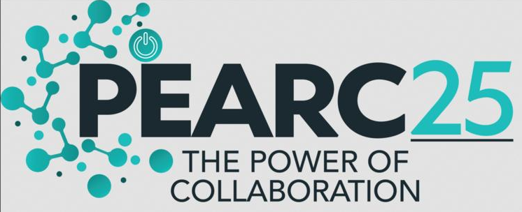
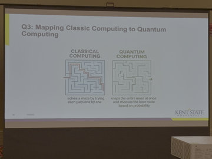
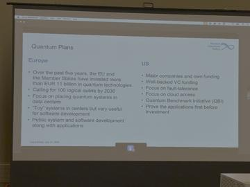
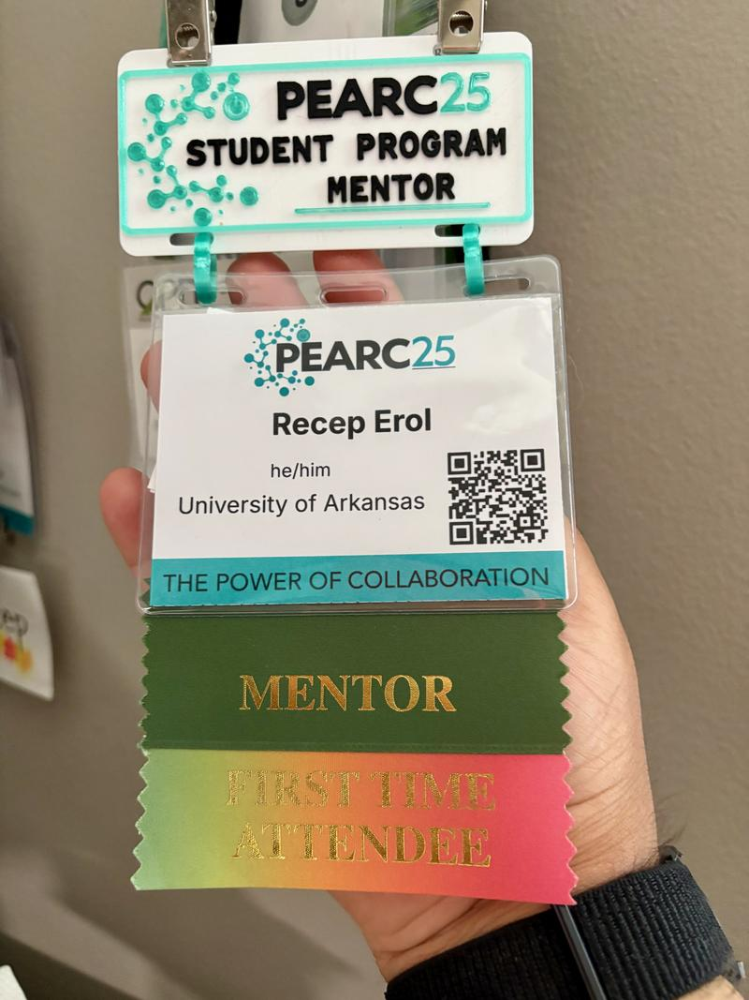
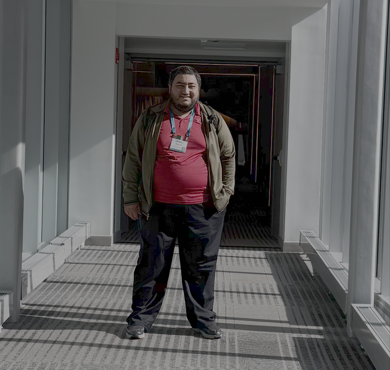

+++
title = 'PEARC25 Reflections: A Step Forward in HPC and Scientific Computing'
date = 2025-08-11T10:47:48-05:00
tags = ["High Performance Computing", "Supercomputing", "Scientific Computing", "PEARC", "Quantum Computing", "Career Development"]
categories = ["High Performance Computing", "Conferences"]
+++

## **Introduction**

*<small>PEARC25 Columbus, OH</small>*

This year, I had the opportunity to attend the [PEARC25](https://pearc.acm.org/pearc25/) conference, supported by the [ACM Early Career Travel Grant](https://pearc.acm.org/pearc25/travel-grants-opportunities/). While I’ve previously attended SC conferences, PEARC was a first for me. My main goals were to network, deepen my understanding of HPC research, and learn about the latest developments in the scientific computing community especially quantum computing.

The HPC community is vast, and I feel fortunate to be part of it. These conferences are invaluable for staying current with state-of-the-art practices and connecting with the people who are pushing the boundaries of science. I am passionate about contributing to this progress and am working toward becoming one of those who help move science forward.

---

## **Insights from the HPC Community**

One of the highlights of PEARC25 was meeting an HPC administrator with over 30 years of experience in a leading supercomputing center. He shared an important observation: before the rise of AI, HPC and supercomputing centers were far less active. AI has dramatically increased demand for computation, bringing new workloads from a wide variety of domains. Today, many HPC facilities operate at or near 100% capacity.

This shift highlights the growing intersection of AI and HPC—and the need for continued innovation in resource allocation, scalability, and efficiency.

---

## **Exploring Quantum Computing**

Quantum computing is an area I’m eager to explore further. Several neighboring states are investing heavily in this domain, and I came to PEARC25 with the goal of engaging with the quantum computing community.

I was seeking answers to several questions:

* What kinds of scientific problems are currently being solved with quantum systems?
* Are there opportunities for parallel or distributed computing in quantum architectures?
* Where do traditional compute resources fall short, and how does quantum fill that gap?
* What does the quantum software stack look like, and what skills are required to work with it?

I attended presentations that offered valuable perspectives on how classical computing problems can be mapped to quantum systems. A key insight was that starting with this mapping process could be an ideal entry point for building practical quantum applications.

|  |  |
| --- | --- |
| <small>Mapping classic computation problems to quantum</small> | <small>Europe has some progress on quantum computing</small>

Another important takeaway was the comparison between Europe’s and the USA’s quantum initiatives. Europe has made notable progress over the past years, with significant investment, infrastructure placement in data centers, and active public software development. This model could serve as a valuable reference for the USA to accelerate its own quantum transition and research ecosystem.

I am also considering the best path for developing expertise in this field—whether through self-study, a master’s program, or a set of certificate programs that I can train myself and become a part of this tremendous community.

---

## **Mentorship Experience**

*<small>Recep's PEARC25 badge</small>*

I was honored to participate in the Protégé-Mentor program at PEARC25. Mentoring offers a unique opportunity to give back to the community by accelerating someone’s progress. In many cases, the right guidance can reduce a learning curve from weeks or months to just hours.

These programs play a vital role in making high-performance computing more accessible, helping newcomers overcome challenges and build skills in a structured, supportive way.

---

## **Looking Ahead**

*<small>A snapshot from PEARC25 conference</small>*

Attending PEARC25 was an enriching experience, both professionally and personally. I gained valuable insights into emerging technologies, strengthened my professional network, and had the chance to contribute as a mentor.

I’m already looking forward to PEARC26—and yes, I’ll definitely be keeping an eye out for the swag tables.

**Happy learning, and see you at the next one!**
