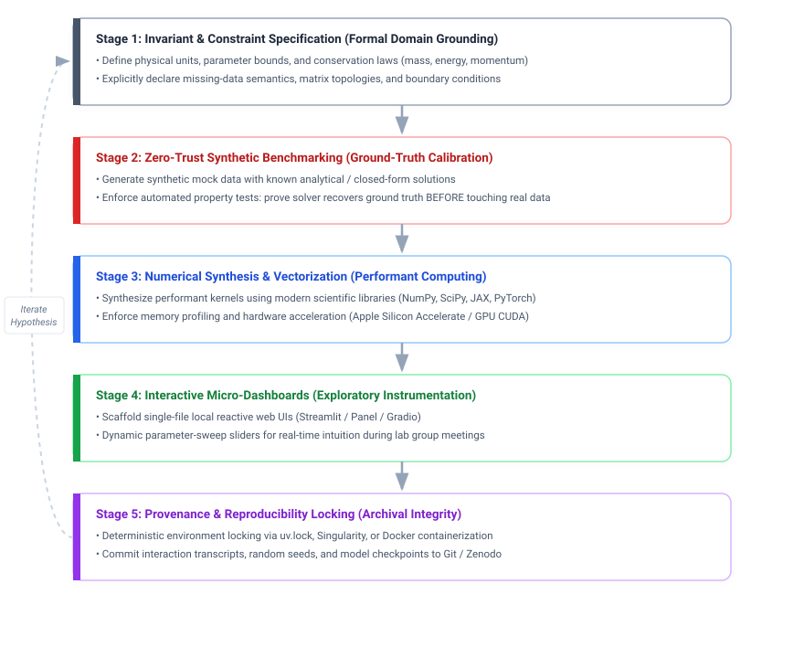
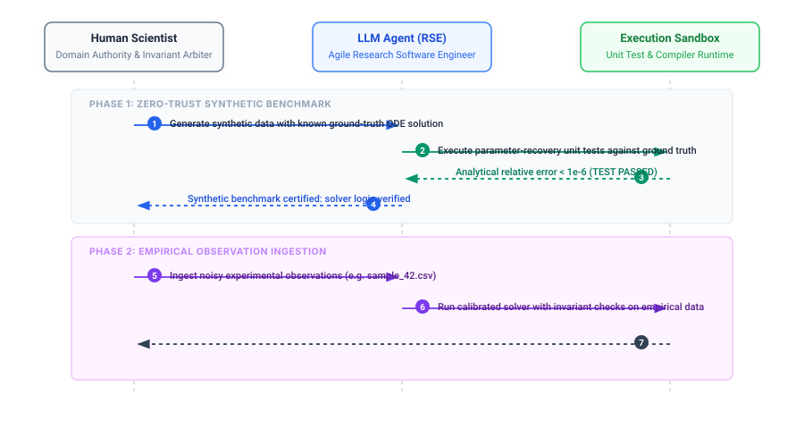
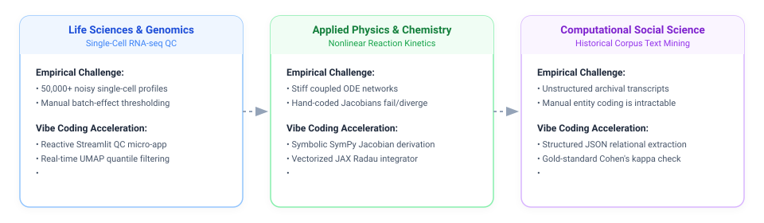

+++
title = "Vibe Coding for Scientists and Researchers"
date = 2026-10-16T12:08:00-05:00
aliases = ["/posts/scientific-vibe-coding/"]
+++

*Moving Science Forward with a New Way of Practice*

---

## Abstract

In empirical research, progress is frequently constrained not by the breadth of human scientific imagination, but by the friction of computational implementation. While the broader tech community has embraced "vibe coding" as a rapid prototyping methodology for consumer applications, this article formalizes **vibe coding habits for scientists and researchers** as a disciplined, hypothesis-driven workflow for computational scholars, graduate students, and faculty. By coupling declarative natural language intent with zero-trust synthetic benchmarking, invariant assertion, and automated provenance tracking, researchers can compress months of pipeline engineering into hours without compromising scientific reproducibility or mathematical validity.

---

## 1. The "Dark Matter" of Modern Scientific Research

Fred Brooks famously bifurcated software engineering challenges into **essential complexity** (the intrinsic difficulty of the conceptual problem) and **accidental complexity** (the mechanical friction of languages, compilers, syntax, and environments).

In scientific research, accidental complexity consumes a staggering proportion of cognitive labor:

* A doctoral student in biophysics spends three weeks wrestling with deprecated CUDA drivers rather than analyzing molecular dynamics simulations.
* An economist with a novel econometric hypothesis spends days debugging matrix broadcasting shapes in Python rather than testing identifying assumptions.
* An experimental lab loses months of velocity because decades of institutional knowledge are trapped in undocumented legacy MATLAB scripts or Fortran 77 routines written by scholars long departed.

This uncredited friction is the **"Dark Matter" of scientific inquiry**—invisible, exhausting labor that dilutes intellectual focus and delays empirical discovery. 

Developing sound vibe coding habits provides scientists and researchers a principled way to systematically dismantle this accidental complexity.

---

## 2. Conceptual Definition: Vibe Coding Habits for Scientists and Researchers

In the commercial domain, vibe coding is often colloquially described as *"giving up the wheel to an AI and speaking intent into existence."* 

In scientific scholarship, however, "giving up the wheel" without oversight is an abdication of scientific responsibility. Therefore, we define effective **vibe coding habits for scientists and researchers** as:

  Rigorous Vibe Coding = Declarative Intent &times; Formal Invariant Constraints &times; Zero-Trust Verification

Under this paradigm, the division of intellectual labor is sharply delineated:

* **The Human Scientist:** Operates as the **Chief Theorist and Epistemic Arbiter**. The scientist formulates hypotheses, articulates physical conservation laws, defines statistical invariants, identifies failure modes, and rigorously evaluates outcomes.
* **The Foundation Model / Agent:** Operates as the **Agile Research Software Engineer (RSE)**. The model translates mathematical specifications into vectorized code, generates synthetic test fixtures, navigates dependency graphs, formats publication-ready visualizations, and resolves execution tracebacks.

---

## 3. The 5-Stage Vibe Coding Protocol for Research

To harness generative velocity while preserving experimental validity, effective vibe coding habits for scientists and researchers adhere to a strict 5-stage loop:

---

## 4. Deep Dive: The Operational Disciplines

### Practice 1: The Zero-Trust Synthetic Data Protocol
**The Cardinal Rule:** Never let an AI-generated model operate on scarce, noisy empirical data until it has proven itself against synthetic ground truth.

<blockquote>
  <strong>Prompt Pattern:</strong>
  
<em>&ldquo;Before writing the fitting algorithm for our experimental spectroscopy dataset, write a generator that simulates synthetic spectra with 5 known Lorentzian peaks and Gaussian noise. First prove that your algorithm recovers the 5 peak centers within &plusmn;0.01 cm-1. Only when that unit test passes will we feed in <code>sample_run_42.csv</code>.&rdquo;</em>

</blockquote>

---

### Practice 2: Declarative Invariant Prompting
LLMs will happily synthesize equations that violate conservation of energy, allow negative absolute temperatures, or produce unnormalized probability distributions unless explicitly constrained.

<blockquote>
  <strong>Prompt Pattern:</strong>
  
<em>&ldquo;Write a parameter optimization routine for this multi-compartment pharmacokinetic model. Enforce the following hard invariants at every optimization iteration:</em>

  <ol>
    <li><em>Drug concentration C(t) &ge; 0 for all t &ge; 0.</em></li>
    <li><em>Total mass clearance must strictly balance cumulative excretion.</em></li>
    <li><em>If any step produces a condition number &kappa; &gt; 108, raise a custom <code>IllConditionedMatrixWarning</code> and fallback to a regularized Levenberg-Marquardt step.&rdquo;</em></li>
  </ol>
</blockquote>

---

### Practice 3: Instant Exploratory Micro-Dashboards
Rather than endlessly tweaking static matplotlib figures in Jupyter notebooks, adopting vibe coding habits enables scientists and researchers to manifest interactive exploratory instruments in minutes.

<blockquote>
  <strong>Prompt Pattern:</strong>
  
<em>&ldquo;Take our validated differential equation solver and wrap it into a single-file Streamlit application. Add live sliders for parameters kon &isin; [0.01, 10.0] and koff &isin; [0.001, 1.0]. Render the phase portrait alongside the time-series plot in real-time, and add an 'Export Publication-Grade SVG (300 DPI)' button with Nature-style typography.&rdquo;</em>

</blockquote>

---

### Practice 4: Rescuing "Dark Code" (Legacy Algorithmic Modernization)
One of the most transformative applications of vibe coding habits for scientists and researchers is liberating legacy algorithms from obsolete codebases.

<blockquote>
  <strong>Prompt Pattern:</strong>
  
<em>&ldquo;Here is a 1988 Fortran 77 subroutine computing turbulent boundary layer velocity profiles:</em>

  <ol>
    <li><em>Step 1: Explain the underlying physical equations in mathematical notation.</em></li>
    <li><em>Step 2: Write a vectorized implementation in Python using NumPy and JAX.</em></li>
    <li><em>Step 3: Write an automated numerical parity test comparing the outputs across 105 random inputs with a maximum relative tolerance of 10-7.&rdquo;</em></li>
  </ol>
</blockquote>

---

## 5. Interdisciplinary Domain Case Studies

### Case A: Biophysics & Stiff Differential Systems
* **Challenge:** Solving coupled chemical reaction networks with rate constants spanning 6 orders of magnitude requires stiff ODE integrators. Graduate students often struggle with manual Jacobian formulation.
* **Vibe Coding Acceleration:** The researcher describes the stoichiometric matrix and reaction orders. The model computes the symbolic analytical Jacobian via SymPy, vectorizes the residual vector in JAX, and hooks it into `scipy.integrate.solve_ivp(method='Radau')`. Time spent: 15 minutes instead of 4 days.

### Case B: Genomics & Single-Cell Sequencing Quality Control
* **Challenge:** Inspecting 50,000 single-cell profiles across 20 experimental batches requires continuous filtering based on mitochondrial gene percentage, read counts, and doublet detection.
* **Vibe Coding Acceleration:** The postdoctoral fellow prompts an autonomous coding assistant to build an interactive dashboard with dynamic threshold sliders. The lab PI can interactively scrub through batch distributions during a weekly meeting, instantly visualizing how varying threshold filters impact downstream cluster separation.

### Case C: Computational Social Sciences & Historical Archives
* **Challenge:** Extracting sociological networks from thousands of unstructured 19th-century diplomatic transcripts without building a manual training dataset from scratch.
* **Vibe Coding Acceleration:** The researcher instructs the model to design an iterative entity-extraction and relationship-graph pipeline with structured JSON outputs. Crucially, the prompt mandates that 10% of documents are evaluated against a human-verified gold standard, calculating precision, recall, and Cohen's kappa before processing the full historical corpus.

---

## 6. Academic Integrity, Peer Review, and Provenance

As vibe coding habits become pervasive across research groups, scientists and researchers must navigate institutional scrutiny and journal standards.

### How to Document AI-Assisted Pipelines in Peer-Reviewed Journals
Scientific journals (such as *Nature*, *Science*, and *PNAS*) require transparent methodology reporting. Transparency is an asset, not a liability:

> **Recommended Methods Section Language:**  
> *"Computational scripts and interactive visualization tools were synthesized using Claude 3.5 Sonnet / Gemini 1.5 Pro via an iterative specification protocol. Algorithmic implementations were formally verified against synthetic benchmark test fixtures with known analytical solutions prior to empirical ingestion. All system prompts, dependency manifests (`uv.lock`), and automated unit tests are version-controlled and deposited in Zenodo (DOI: 10.5281/zenodo.XXXXXX). No proprietary empirical patient data was transmitted to commercial model endpoints."*

### Data Privacy and Air-Gapped Environments
Under HIPAA, FERPA, and institutional IP mandates, proprietary clinical or experimental data cannot be transmitted over commercial API endpoints:
* **The Solution:** Use local, open-weight foundational models (e.g., DeepSeek-Coder, Llama 3.1) running locally on university HPC clusters or Apple Silicon hardware via **Ollama** or **vLLM**.
* **Air-Gapped Workflow:** Code generation and architectural scaffolding can be executed locally on synthetic schemas, ensuring that raw proprietary data never leaves institutional storage.

---

## 7. Conclusion: Expanding the Frontier of Human Curiosity

Adopting vibe coding habits is not a shortcut around deep thought—it is a liberation from syntactic drudgery.

Throughout the history of science, the most profound breakthroughs emerged when thinkers were liberated to ask bolder, more speculative questions. By reducing the activation energy required to prototype computational models, test complex empirical hypotheses, and build exploratory instruments, cultivating sound vibe coding habits empowers scientists and researchers to turn every graduate student, postdoc, and faculty member into a formidable computational laboratory.

The frontier of scientific discovery is vast. The computational tools to explore it should move at the speed of thought.
