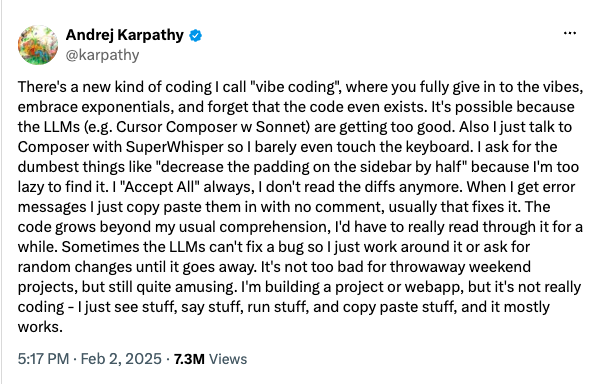
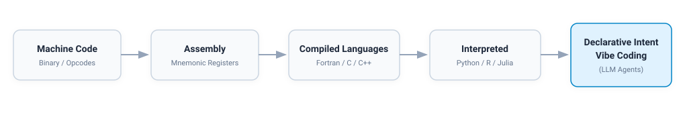
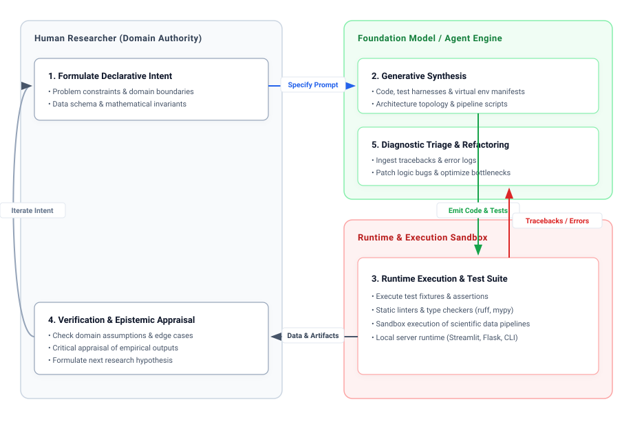
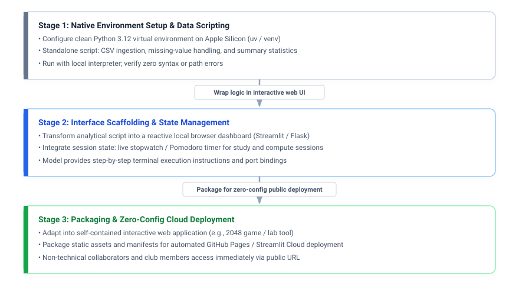

+++
title = "Vibe Coding: Building at the Speed of Thought"
date = 2026-10-15T11:37:00-05:00
+++

*From Imperative Syntax to Declarative Intent in Computational Scholarship*

---

## Abstract

In the contemporary computational landscape, the primary bottleneck of software creation is migrating from mechanical syntax to conceptual clarity. Coined by Andrej Karpathy, the term "vibe coding" captures a paradigm shift in which natural language serves as a declarative programming interface, with large language models (LLMs) managing implementation, scaffolding, and error triage. For academic researchers, doctoral candidates, and interdisciplinary scholars, this transformation represents both an unprecedented accelerator for scientific tooling and a pedagogical challenge to traditional notions of algorithmic literacy. This article outlines the theoretical foundations, operational mechanics, epistemic trade-offs, and verification disciplines required to wield vibe coding with scientific rigor.

---

## 1. Introduction: The Genesis of "Vibe Coding"

In early February 2025, artificial intelligence researcher Andrej Karpathy articulated a trend quietly reshaping software engineering:

<blockquote class="twitter-tweet" data-dnt="true" align="center">
  
There&#39;s a new kind of coding I call &quot;vibe coding&quot;, where you entirely give up the wheel to the AI and just speak your intent, copy-paste error messages, and guide the model...

  &mdash; Andrej Karpathy (@karpathy) <a href="https://twitter.com/karpathy/status/1886192184808149383?ref_src=twsrc%5Etfw">February 3, 2025</a>
</blockquote>

  
  
<em><a href="https://x.com/karpathy/status/1886192184808149383" target="_blank">Andrej Karpathy's original post on X (February 3, 2025)</a> introducing the concept of vibe coding.</em>

For more than half a century, programming demanded total fidelity to formal grammars. A computational thinker had to translate high-level conceptual invariants into deterministic, syntax-bound tokens where an errant comma, unhandled pointer, or misplaced indentation could compromise execution. 

Today, foundation models operate as semantic translation layers. Developers and domain experts no longer construct systems exclusively line-by-line; rather, they articulate high-level intent in natural language. The underlying neural architecture synthesizes the code, constructs the project topology, and assists in runtime execution.

We describe this phenomenon as **building at the speed of thought**. The traditional latency between hypothesizing an algorithmic tool and realizing a functional prototype has collapsed from weeks to minutes.

---

## 2. Theoretical Framing: Natural Language as the Ultimate Abstraction

The history of computer science is an unbroken continuum of abstraction:

Each epoch encountered initial skepticism from purists who argued that higher-level abstractions would distance practitioners from the underlying mechanics of execution. Yet, each layer ultimately freed human intellect to solve problems of greater magnitude:

1. **Democratization of Computational Agency:** Scholars across the physical sciences, computational humanities, and clinical disciplines frequently conceive sophisticated analytical pipelines but lack the engineering fluency to stand up web interfaces, distributed databases, or performant microservices. Vibe coding provides an expressive, low-barrier interface to computational execution.
2. **Reallocation of Cognitive Bandwidth:** Engineering entails multiple cognitive layers: domain logic, software architecture, UI/UX, and syntactic mechanics. By delegating boilerplate implementation to an LLM, the scholar's attention re-centers on domain validity, hypothesis testing, and architectural coherence.
3. **Ubiquitous, Frictionless Prototyping:** Ideation is unbundled from specialized local toolchains. A researcher can prototype a data parser, an interactive dashboard, or a simulation script on a tablet or mobile device in the field, testing feasibility prior to institutional investment.

---

## 3. The Operational Loop: Iterative Dialogic Synthesis

Far from being a passive incantation, vibe coding operates as an **iterative dialectic** between human intent and machine synthesis:

The execution lifecycle comprises four recurring steps:

1. **Intent Articulation (Prompt Engineering as Formal Specification):** The researcher establishes the problem constraints, input/output contracts, and operating environment.
2. **Generative Synthesis:** The model constructs the system scaffolding, configuration files, dependency manifests, and business logic.
3. **Runtime Execution & Diagnostic Triage:** When runtime anomalies or edge-case tracebacks emerge, the human feeds the raw execution output back into the model's context window for immediate diagnosis and automated refactoring.
4. **Metacognitive Interrogation:** The researcher instructs the model to inspect its own assumptions: *"Critique your previous design, identify potential memory bottlenecks, and expose unhandled edge cases."*

---

## 4. Pedagogical Case Study: Scaffolding from Scratch

To ground this paradigm, consider an interdisciplinary researcher with zero prior programming experience working on macOS (Apple Silicon M-Series). The objective is to progress from basic environment setup to a deployed interactive tool.

Throughout this trajectory, the user does not need to master DOM manipulation, build tools like Vite, or Docker containerization. The model abstracts away the deployment pipeline while educating the user at each juncture:

* **Stage 1 Prompt Example:**
  > *"I am using an M3 MacBook Pro. Guide me through configuring a clean Python 3.12 virtual environment. Write a standalone script that loads a CSV file, computes summary statistics, and handles missing data."*
* **Stage 2 Prompt Example:**
  > *"Transform this script into a clean local browser dashboard using Streamlit. Include an interactive stopwatch timer to track data-analysis intervals. Provide terminal commands to launch the local server."*
* **Stage 3 Prompt Example:**
  > *"Adapt this interface into a standalone browser application (e.g., an interactive 2048 game for our club members). Package all assets for zero-cost, zero-configuration deployment via GitHub Pages so non-technical users can access it immediately via a public URL."*

### In-Screen Interactive Execution: The Gemini Web Application Runtime

A decisive paradigm shift in modern conversational AI—most notably demonstrated by **Google Gemini** (and generative UI agent canvases)—is the ability to **directly launch and run interactive web applications live within the Gemini screen itself**.

In traditional workflows, testing a generated web tool required switching windows, installing virtual environments, spawning local port listeners (`localhost:8080`), and toggling between editor and browser tabs. Today, Gemini embeds an integrated, secure execution canvas:

1. **Instant Web Runtime Execution:** When prompted to design an interactive application, Gemini synthesizes the full HTML5/CSS/JavaScript client logic or Python web service and spins up a live, interactive preview directly inside the chat interface.
2. **Real-Time Interactive Play & Testing:** Users can immediately play games, manipulate interactive UI sliders, input test records, and evaluate UX responsiveness without ever leaving the conversation.
3. **Conversational Visual Refactoring:** If an animation lags or a layout breaks, the user simply replies in natural language: *"Make the tile slide transitions smoother, add a persistent high-score leaderboard, and enlarge the score badge."* Gemini recompiles the application state and refreshes the live interface in real time.

  
  
<em>Figure: A complete, fully playable 2048 web application synthesized from natural language intent and launched live for interactive play within the browser.</em>

#### The Vibe Coding Prompt Behind the 2048 Game
The 2048 web application above was constructed using a single structured intent prompt:
> *"Assume you're a veteran Python programmer and a client asked you to develop a project for a high school chess club: an interactive 2048 web app in Python (Flask/Jinja) and vanilla JavaScript. Keep track of user scores across sessions. Make the project run with a single `make run` command, providing automated dependency setup and clean teardown."*

Within moments, the entire architecture—application routes, database persistence, responsive CSS grid, sliding tile logic, and Makefile orchestration—was synthesized, validated, and ready to play.

---

## 5. Critical Epistemic Analysis: The Promises and Perils

In an academic or institutional setting, intellectual honesty mandates a clear-eyed accounting of the vulnerabilities inherent in this approach:

| Dimension | The Promise | The Peril / Failure Mode | Mitigation Strategy |
| :--- | :--- | :--- | :--- |
| **Velocity** | Compresses months of prototyping into days or hours. | Induces superficial understanding; risks brittle copy-paste cargo culting. | Enforce test-driven development (TDD) via model-generated test suites. |
| **Accessibility** | Lowers the activation energy for non-specialist scholars. | Fosters uncritical trust in silent, mathematically flawed logic. | Introduce invariant assertions and compare against known benchmark analytical solutions. |
| **Refactoring** | Instant porting across languages (e.g., Python $\to$ Rust). | Hallucinated parameters in scientific libraries (`numpy`, `scipy`, `R`). | Validate against official library documentation and static linters (`ruff`, `mypy`). |
| **Security** | Rapid integration of authentication and API wrappers. | Accidental commitment of unredacted API secrets; use of deprecated packages. | Automated secret scanning with `.env` sandboxing and supply-chain auditing (`pip-audit`). |

> **The Axiom of Rigorous Vibe Coding:**  
> *Vibe coding accelerates implementation, but it amplifies the demand for verification.* When syntax is automated, the programmer's core discipline shifts from **transcribing instructions** to **formal verification, property-based testing, and architectural validation**.

---

## 6. The Scientific Horizon: Metacognitive Prompting and Beyond

Vibe coding is not the abdication of engineering discipline; it is the elevation of computational literacy. As modern development environments and autonomous agent frameworks integrate runtime sandboxes, static linters, and formal theorem provers, the dialogue between human intuition and machine execution will become the standard medium of creation.

For scholars, faculty, and doctoral researchers, mastering vibe coding is not about cutting corners—it is about wielding an intellectual exoskeleton that allows your ambition, rather than your syntactic recall, to dictate the frontiers of your inquiry.
